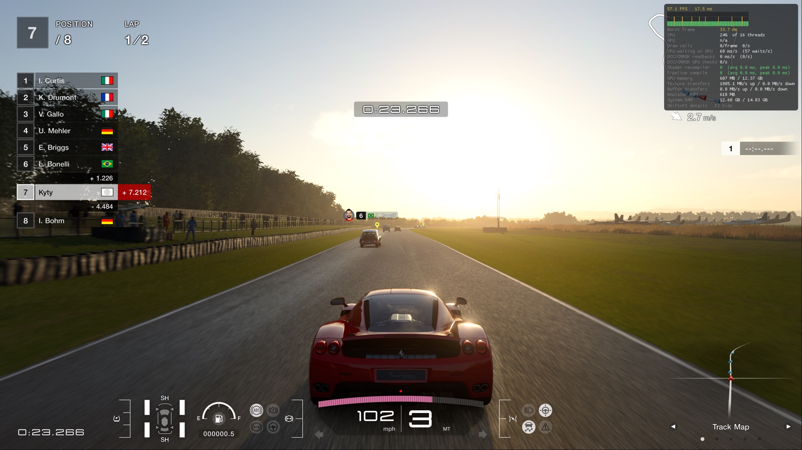
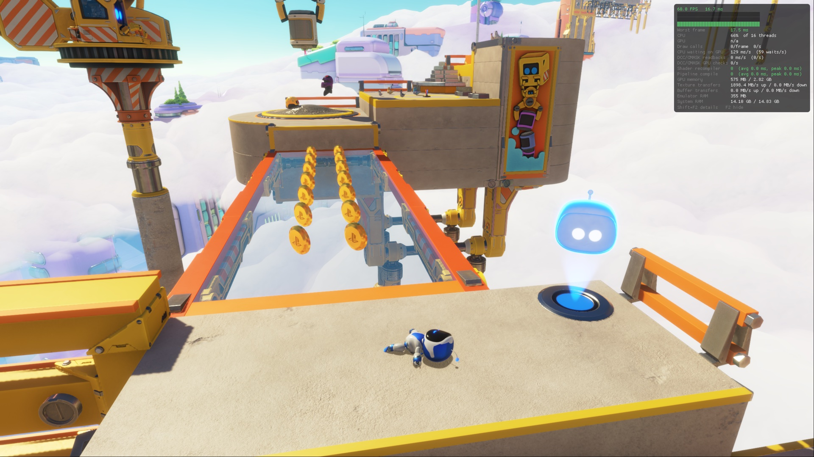
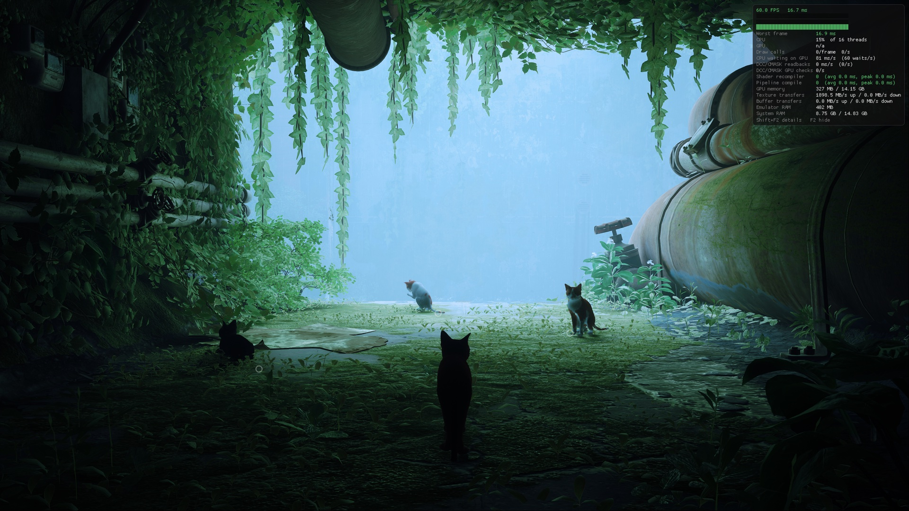
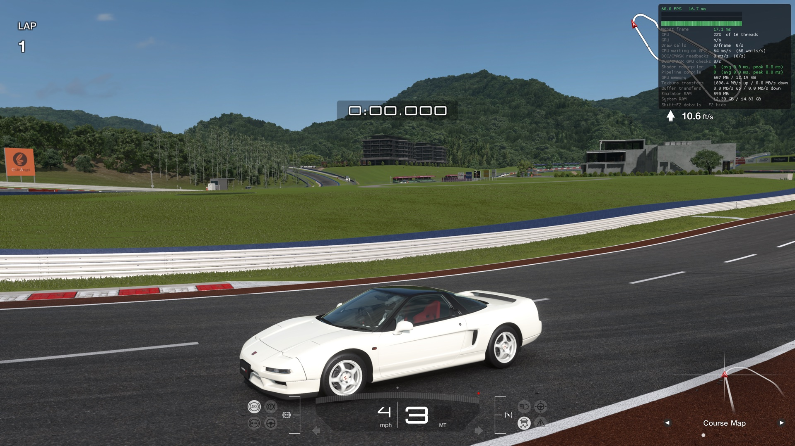
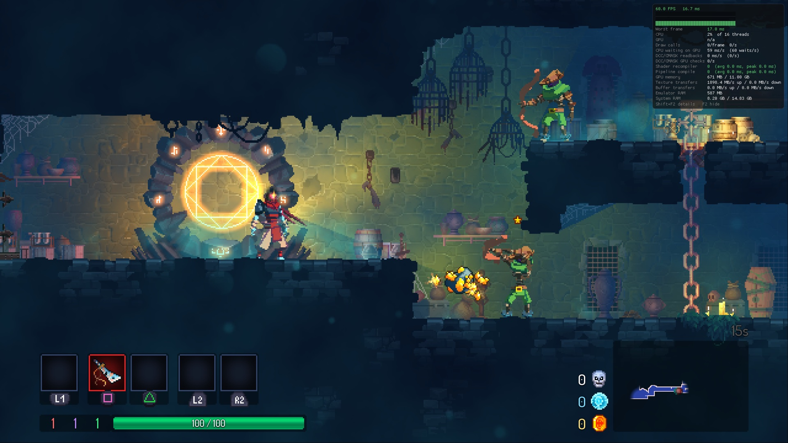

MY BC-250 BROKE TODAY DURING TRANSPORTATION AND AS OF TODAY I WON'T BE ABLE TO KEEP WORKING ON THIS PROJECT. I DON'T HAVE A SPARE ONE OR ANY OTHER GAMING DEVICES, SO I WON'T BE ABLE TO WORK ON ANYTHING OR GAME ON ANYTHING.
SORRY GUYS.
RIP
# KytyPS5-Native BC-250 — plug-and-play beta

A ready-to-play package of this community **GitHub fork of [Superkeka's KytyPS5-Native](https://github.com/superkeka/KytyPS5-Native)** (not a separate emulator, not an official Sony project) for the
**AMD BC-250** on **SteamOS** and **CachyOS** (Bazzite and other Arch/Fedora systems are supported by the setup but
less tested). Download one file, prepare your system once, add **your own games**, and play. Every fix, per-game
setting, cheat list and upscaler this fork uses is already inside the package.

The only things you provide:

- **Your games** (PS5 games you own, as extracted folders or `.zar` archives).
- **Optionally, your Lossless Scaling** (from Steam), only if you want Lossless Scaling frame generation. Everything
  else, including HLX FSR 4 upscaling and native FSR 3 frame generation, works without it.

> [!IMPORTANT]
> Unaffiliated with Sony Interactive Entertainment or PlayStation. No games, firmware, keys or saves are included.
> Use only game files you obtained legally.

[Downloads](#downloads) · [1. Prepare the system](#1-prepare-the-system-once) · [2. Install](#2-install-kytyps5) ·
[3. Add games](#3-add-your-games) · [4. PS5 Minimal Mode](#4-ps5-minimal-mode-optional-recommended) ·
[Upscaling and frame generation](#upscaling-and-frame-generation) · [Tested games](#tested-games) ·
[Troubleshooting](#troubleshooting) · [Credits](#credits-and-licenses)

## Downloads

From [Releases](https://github.com/dmorazasanchez/KytyPS5-Native-beta/releases), pick **one** of the first three:

| File | What it is |
| --- | --- |
| `KytyPS5-BC250-<version>-x86_64.AppImage` | The whole emulator in one file. Recommended. |
| `KytyPS5-BC250-<version>-x86_64.tar.gz` | The same program as a folder (no FUSE needed). Extract, then use `./AppRun`. |
| `KytyPS5-BC250-<version>-x86_64.zip` | The same folder as a ZIP. |
| `KytyPS5-BC250-<version>-PS5-Minimal-Mode.tar.gz` | Optional separate installer for PS5 Minimal Mode, the low-RAM game session. |
| `KytyPS5-BC250-<version>-source.tar.gz` | Source of the launcher and packaging. |
| `SHA256SUMS` | Checksums: `sha256sum -c SHA256SUMS`. |

Keep the AppImage or the extracted folder in a permanent place (for example `~/Applications`). The menu entry,
Steam shortcut and Minimal Mode all point to it. If you move it, run `--install-desktop` again (and the Minimal Mode
installer, if you use it).

## What you need

| | Requirement |
| --- | --- |
| Hardware | AMD BC-250 (GPU `1002:13fe`). Ordinary PC GPUs are not supported. |
| BIOS | **512 MB UMA / VRAM.** On the modded P3.00 "Chipset Menu" BIOS: *Chipset → GFX Configuration → UMA Frame Buffer Size → 512M*. On the stock BIOS, set it without flashing with [bc250_memcfg](https://github.com/fanoush/bc250_memcfg): `sudo ./bc250memcfg UMA_SIZE 512`. More VRAM takes RAM that games need. |
| System | SteamOS 3.9 (tested: 3.9.5), CachyOS (tested), or another x86-64 Linux with glibc 2.38+, a working amdgpu/Mesa (RADV) stack and systemd. |
| RAM | 16 GB (the BC-250's). Large games use about 13–14 GB of it; see [Memory](#memory-why-the-session-matters). |
| Disk | About 2.5 GB for KytyPS5, plus your games. |

## 1. Prepare the system (once)

Do this in **Desktop Mode**, in a terminal (SteamOS: *Konsole*). It needs your password (on SteamOS, set one first
with `passwd` if you never did).

```sh
chmod +x KytyPS5-BC250-*-x86_64.AppImage
./KytyPS5-BC250-*-x86_64.AppImage --prepare-system
```

Then **reboot**, and check:

```sh
./KytyPS5-BC250-*-x86_64.AppImage --prepare-system --status
```

Every line should say `OK`. `--prepare-system` detects your system and adds only what is missing:

| Setting | Why | SteamOS | CachyOS / Arch with Limine | Arch with GRUB | Bazzite / rpm-ostree |
| --- | --- | --- | --- | --- | --- |
| `amdgpu sched_policy=2 vm_update_mode=0 cwsr_enable=0` | KytyPS5's GPU queues (KFD). **Without them games stall on a black screen**: SteamOS's defaults (0 / −1 / 1) make Ghost of Yōtei stop at its first frames. | `/etc/modprobe.d/kytyps5-native.conf` | `KERNEL_CMDLINE` lines in `/etc/default/limine` | `/etc/default/grub` | kernel arguments |
| `ttm.pages_limit=3670016` (14 GiB GTT) | Games with more than 8 GiB of memory stall while loading without it. | `/etc/default/grub.d/kytyps5-native.cfg` + `update-grub` | same Limine lines + `limine-update` | `/etc/default/grub` + `grub-mkconfig` | kernel argument |
| `kyty-lodhw` GPU helper | Sets the PS5 GPU registers the games expect. | systemd service | systemd service | systemd service | systemd service |

- A value you already set yourself is never overwritten; `--status` shows it as `CONFLICT` so you can decide.
- `--prepare-system --dry-run` shows the exact changes first. `--prepare-system --revert` removes exactly what it
  added (then reboot). Everything it added is recorded in `/var/lib/kyty-beta-system/prepare-system.json`.
- On SteamOS these files live in `/etc` and `/var`, which SteamOS keeps across updates; the read-only `/usr` is only
  unlocked for the moment `update-grub` runs. A SteamOS update that changes the kernel keeps them.
- It does not touch the BIOS, the kernel package, the GPU driver module or the clocks.

### Recommended: GPU clock governor

Without a governor the BC-250's GPU stays near **1500 MHz**. Games run, but upscaling costs more time per frame
(measured with Ghost of Yōtei: HLX FSR 4 took **5.5 ms** a frame at the default clock and **4.4 ms** with the governor).
Install [cyan-skillfish-governor](https://github.com/filippor/cyan-skillfish-governor) (SMU branch):

- **CachyOS:** `cyan-skillfish-governor-smu` from the `bc250-cachyos` repository of
  [linux-cachyos-bc250](https://github.com/MastaG/linux-cachyos-bc250).
- **SteamOS:** through [bc250-steamos](https://github.com/keyboardspecialist/bc250-steamos) (*Power and thermals*).

Pick a clock range your cooling can hold; the setup above does not change clocks. `--doctor` warns when no governor
runs.

### Optional: patched amdgpu (more memory for frame generation)

Games run on the stock amdgpu with the options above. Superkeka's BC-250 amdgpu patch adds the PS5's second graphics
ring and interrupt routing; with the stock module, heavy games measured about **400 MiB more GPU memory**, enough to
keep native frame generation paused in Ghost of Yōtei (Helix upscaling still runs).

- **CachyOS:** the `linux-cachyos-bc250` kernel from [linux-cachyos-bc250](https://github.com/MastaG/linux-cachyos-bc250)
  includes it.
- **SteamOS:** build it for your kernel with [`tools/bc250-amdgpu`](tools/bc250-amdgpu/README.md). This replaces the
  GPU driver module; read that README first, keep its rollback, and rebuild after a SteamOS kernel update.

`--prepare-system` adjusts its options automatically when the patched module is loaded.

## 2. Install KytyPS5

```sh
./KytyPS5-BC250-*-x86_64.AppImage --install-desktop     # adds "KytyPS5 Beta" to the application menu
./KytyPS5-BC250-*-x86_64.AppImage --doctor              # checks everything; changes nothing
```

Start **KytyPS5 Beta** from the menu. The launcher works with a controller (DualSense, DualShock 4, Xbox) or a
keyboard and mouse.

**Steam Game Mode (SteamOS):** in Desktop Mode, Steam → *Add a Game* → *Add a Non-Steam Game* → pick
**KytyPS5 Beta**. Then in its *Properties → Compatibility*, leave *Force the use of a specific Steam Play compatibility
tool* **off**: KytyPS5 is a Linux program, not a Windows one.

**Without FUSE** (some minimal systems): use the `.tar.gz`, or run the AppImage with `--appimage-extract` and start
`squashfs-root/AppRun`. If a ZIP extractor dropped the executable bits:
`chmod +x AppRun bin/* runtime/run-elf *.sh emulator/kyty_* framegen/mako/lib/*`.

## 3. Add your games

In the launcher: **Settings → Game folders → Add**, and pick the folder that holds your games. KytyPS5 finds:

- **Extracted games:** a folder with `eboot.bin` and `sce_sys/param.json`.
- **`.zar` archives:** played directly, without extracting.
- **Updates and DLC:** keep them merged into the game (the usual patched dumps). For Ghost of Yōtei, the
  Complete Edition's add-on licences are registered automatically.

External drives work. Keep the drive mounted under the same path; after you move games, add the new folder again.

## 4. PS5 Minimal Mode (optional, recommended)

PS5 Minimal Mode is a separate game session: it closes the desktop (KDE, Steam and their background services) and
starts only a small compositor (labwc), audio and the KytyPS5 launcher, the way a console boots into its game. That
leaves the most RAM for games, which upscaling and frame generation need. You return to your desktop without
rebooting.

Download `KytyPS5-BC250-<version>-PS5-Minimal-Mode.tar.gz`, and with KytyPS5 already installed (step 2):

```sh
tar -xf KytyPS5-BC250-*-PS5-Minimal-Mode.tar.gz
cd KytyPS5-BC250-*-PS5-Minimal-Mode
./install.sh --check     # shows what it will install on this system
./install.sh             # installs (asks for your password)
```

The installer detects the system and uses the matching setup:

| | SteamOS | CachyOS / Arch |
| --- | --- | --- |
| Compositor | labwc bundled with the installer (SteamOS has none), with the host's Wayland client library so it matches SteamOS's Mesa | the system's `labwc` (`sudo pacman -S labwc` if missing; the bundled one is used otherwise) |
| Login | `systemd-userdbd` kept running during the switch (SteamOS otherwise fails the session login) | same, where the unit exists |
| Return | back to SteamOS Desktop Mode | back to your display manager's session |
| Needs | nothing else | `xorg-xwayland dbus pipewire pipewire-pulse wireplumber polkit` (the installer names any that are missing) |

**Use it:** start **KytyPS5 PS5 Minimal Mode** from the application menu, or add that entry to Steam as a non-Steam
game to start it from Game Mode. **Save your work first:** entering closes your desktop apps and turns off networking
until you return.

**Leave it:** in the launcher, *Control centre → Return to Desktop Mode*, or press **Super+Shift+E**. If the screen
ever stays black: **Ctrl+Alt+F4**, log in, and run `sudo /var/lib/kyty-beta-system/session/ps5-minimal-control desktop`.

The AppImage can install the same session with `--install-gaming-mode`. Remove it with `./install.sh --uninstall`
(or the AppImage's `--uninstall-system`); this also removes the GPU helper, so run `--prepare-system` again if you
keep using KytyPS5. Saves and settings stay.

## Upscaling and frame generation

Set these per game in the launcher (**game → Settings → Upscaling / Frame generation**), or globally in Settings.
The [tested games](#tested-games) start with their tested choice.

| Option | What it does | Needs |
| --- | --- | --- |
| **Upscaler → HLX FSR 4** | [HelixSR](https://github.com/lonewolf0622/HelixSR)'s FSR 4-class upscaler, run in place of the game's own FSR 3. | Nothing: included and set up automatically. |
| **Upscaler → HLX DLSS** | HelixSR's DLSS Model E upscaler. | Built once on your PC: `--setup-helix-dlss` (below). Until then KytyPS5 uses HLX FSR 4. |
| **Upscaler → Auto** | HLX FSR 4 once KytyPS5 has verified the game's upscaler inputs; the game's own otherwise. | Nothing. |
| **Upscaler → Game** | The game's own upscaler. | Nothing. |
| **Render preset** | Render resolution the upscaler starts from: DLAA, Ultra Quality, **Quality** (2560×1440 for 4K), Balanced, Performance, or Dynamic (the game's own). | |
| **Native frame generation → FSR 3** | KytyPS5's own FSR 3.1 frame interpolation from the game's depth and motion vectors. **Auto** turns it on below 50 FPS. | Free RAM (it pauses itself rather than run the game out of memory). |
| **Lossless Scaling FG → Fixed 2× / Adaptive 60 FPS** | Lossless Scaling frame generation through the bundled [MAKO Renderer](https://github.com/eugeniosegala/MAKO) 4.6.0. Replaces native frame generation for that launch. | **Your** Lossless Scaling. |

Only one game upscaler interface is replaced; titles KytyPS5 has no verified route for keep their own upscaler, and
the options above have no effect there.

**HLX DLSS (optional):**

```sh
./KytyPS5-BC250-*-x86_64.AppImage --setup-helix-dlss
```

This runs HelixSR's own setup. It asks before downloading NVIDIA's DLSS 310.7.0 DLL from NVIDIA, builds the network
on your PC (a few minutes) and stores it with KytyPS5. When it lists PC games at the end, press **Enter** on an empty
line: KytyPS5 does not need HelixSR in any PC game. The built files contain NVIDIA's work: they stay on your PC and must
not be shared.

**Lossless Scaling frame generation:** KytyPS5 finds `Lossless.dll` by itself when Lossless Scaling is installed
through Steam (any Steam library, also on an SD card or second drive). Otherwise point it at your copy once:

```sh
./KytyPS5-BC250-*-x86_64.AppImage --setup-lossless /path/to/Lossless.dll
```

If the DLL is not found, the game still starts, with Lossless Scaling off (the reason is in the game's log).

### Memory: why the session matters

On the BC-250 the GPU's memory *is* the system's RAM. Ghost of Yōtei uses about 13.5 GB of the 16 GB, so whatever else
runs takes memory from upscaling and frame generation:

- **Native frame generation** needs about 320 MB free and pauses itself below that (`"why":"memory"` in the log),
  resuming when memory is available again.
- **HLX upscaling** stops if the system runs out of memory (the game continues with its own FSR 3; select it again
  to retry).

So for the best results play in **PS5 Minimal Mode** (or Steam Game Mode), not in a desktop with other apps open.
With the stock amdgpu, frame generation can still stay paused in the heaviest scenes; the
[patched amdgpu](#optional-patched-amdgpu-more-memory-for-frame-generation) gives it the extra room.

## Tested games

What this package was tested with on BC-250 hardware. Other games and versions may work; KytyPS5 applies
version-specific fixes only to the exact versions listed.

| Game | Title ID | Version | Starts with | Notes |
| --- | --- | --- | --- | --- |
| **Ghost of Yōtei** (Complete Edition) | PPSA26344 | 02.002.000 | HLX FSR 4, Quality, 4K output, FSR 3 frame generation | Plays on SteamOS and CachyOS. Complete Edition add-on licences registered automatically (fixes the endless loading screen); VideoDec2 frame-size fix for its videos; ray tracing mode uses the reserved graphics VMID fix (verified in a bounded test, not long sessions). Cheats available. |
| **Demon's Souls** (Deluxe Edition) | PPSA01341 | 01.007.000 | Scream assertion recovery on | Tested on CachyOS. Recovery skips the in-game "Scream" assertion that otherwise stops the game; turn it off in the game's settings if you do not need it. The optional HDR-pass skip only applies to 01.004.000 / 01.007.000. Cheats available. |
| **ASTRO BOT** (EU) | PPSA21567 | 01.018.000 | HLX FSR 4, Performance preset, FSR 3 frame generation | Tested on CachyOS. Its manual upscaling presets are applied only to the exact 01.018.000 EU executable; other regions keep the automatic route. |

**Cheats:** *game → Settings → Cheats* lists the included cheats for Ghost of Yōtei 02.002.000 (infinite health,
one-hit kill, max resources, uncapped FPS) and Demon's Souls 01.007.000 (infinite health, infinite stamina, 9,999,999
souls). They start **off**; turn on the ones you want. You can also import your own patch JSON there.

**Settings you choose always win:** the per-game starting values above only apply until you change that game's
settings. The global defaults are HLX/automatic upscaling, Quality preset, automatic native frame generation and
4K output.

## Data, updates and removal

| Data | Location |
| --- | --- |
| Settings and per-game choices | `~/.config/KytyPS5-Beta` |
| **Saves** | `~/.local/share/KytyPS5-Beta/runtime/_SaveData/<TITLE ID>` |
| Shader caches, trophies | `~/.local/share/KytyPS5-Beta/runtime` |
| Upscalers, Lossless DLL copy, logs | `~/.local/share/KytyPS5-Beta/upscalers`, `lossless`, `logs` |
| Game logs | `~/.config/KytyPS5-Beta/logs` |

**Update:** download the new AppImage, replace the old one at the same path (or run `--install-desktop` from the new
location). Saves and settings are kept. Earlier betas' untouched global defaults (upscaling and frame generation off)
are upgraded to the new defaults once; settings you changed are left alone.

**Back up saves:** copy `~/.local/share/KytyPS5-Beta/runtime/_SaveData`.

**Remove:** `--uninstall-system` (helper and Minimal Mode), `--prepare-system --revert` (driver options; reboot),
`--install-desktop --remove` (menu entries), then delete the AppImage. Delete the two data folders above to remove
saves and settings too.

## Troubleshooting

Start with `--doctor`: every warning names its fix.

| Symptom | Cause and fix |
| --- | --- |
| Black screen or endless loading, Ghost of Yōtei log shows `refused, unknown packet op 0x22` | The amdgpu options are not active. `--prepare-system`, reboot, `--prepare-system --status`. |
| Large game stops while loading | GTT below 14 GiB: same fix. |
| `GPU helper socket` FAIL in `--doctor` | `--prepare-system` (it installs the helper), or `systemctl status kyty-lodhw.service`. |
| Frame generation never turns on | Not enough free RAM. Play in PS5 Minimal Mode, close other apps, use the Quality preset (not Dynamic), or the patched amdgpu. |
| HLX upscaling "stopped" | The system ran out of memory; same as above. Select the upscaler again to retry. |
| Upscaling costs more ms than expected | No GPU governor; the GPU stays near 1500 MHz. |
| Lossless Scaling does nothing | `Lossless.dll` not found: install Lossless Scaling from Steam or use `--setup-lossless`. |
| Minimal Mode screen stays black | Ctrl+Alt+F4, log in, `sudo /var/lib/kyty-beta-system/session/ps5-minimal-control desktop`. |
| The AppImage does not start | FUSE missing: use the `.tar.gz`. glibc older than 2.38: update the system. |

**Reporting a problem:** run `--collect-report`. It saves a local report (system, GPU options, recent logs) for you to
review; nothing is uploaded. Open an issue with it, your system and version, the game and its version, the upscaler
and frame-generation choices, and whether it also happens with frame generation off. Never attach games, keys or
save files.

## Credits and licenses

> **This is a community fork, not an independent reimplementation.**
>
> - **[Superkeka — KytyPS5-Native](https://github.com/superkeka/KytyPS5-Native)** is the main upstream project: the
>   native BC-250 emulator, its GPU work and the amdgpu patch belong to Superkeka and the upstream contributors.
> - **[KytyPS5](https://github.com/KytyPS5/KytyPS5)** is the original emulator it descends from.
> - **[Lonewolf — HelixSR](https://github.com/lonewolf0622/HelixSR)** created HelixSR (HLX FSR 4 and HLX DLSS). This
>   package redistributes the complete, unmodified official HelixSR 3.2.0 release free of charge, as its license
>   allows; this fork does not claim authorship of it.
> - **[Eugenio Segala — MAKO](https://github.com/eugeniosegala/MAKO)**: MAKO Renderer 4.6.0 (GPL-3.0-or-later),
>   bundled unmodified for Lossless Scaling frame generation. It contains no Lossless Scaling.
> - The controller-first launcher is based on the SharpEmu frontend.

This fork adds the packaging, launcher integration, system preparation, Minimal Mode session and BC-250 fixes. The
emulator is GPL-2.0 ([LICENSE](LICENSE)); [Kyty MIT notice](LICENSES/Kyty-MIT.txt). Bundled third-party licenses are
in the package's `licenses/` folder ([THIRD-PARTY](beta/packaging/THIRD-PARTY.md), [source notes](beta/SOURCE.md)).
Not included: games, firmware, Lossless Scaling, NVIDIA's DLSS (HLX DLSS is built from it on your PC), and NVIDIA NGX
SDK headers (needed only to rebuild the HLX helper).

<details>
<summary>Original upstream README and build instructions</summary>

# KytyPS5-Native

PS5 games natively on the PS5 chip under Linux.

A fork of [KytyPS5](https://github.com/KytyPS5/KytyPS5) that runs PS5 games GPU work natively on the
AMD BC-250. The BC-250 has the PS5's APU ("Oberon", GPU gfx1013), so the title's command buffers
run on the hardware after a light translation, and its shaders run with small patches. Vulkan stays for
presentation and as a fallback. It will likely run on a PS5 under Linux too.

> [!IMPORTANT]
> Not affiliated with Sony Interactive Entertainment or PlayStation. No games or system software are
> distributed. Use only game files you obtained legally.

## Status

<table align="center">
  <tr>
    <td align="center">
      <strong>Gran Turismo 7</strong> (60 fps in races)<br>
      
    </td>
    <td align="center">
      <strong>ASTRO BOT</strong> (levels playable)<br>
      
    </td>
  </tr>
  <tr>
    <td align="center">
      <strong>Stray</strong> (60 fps)<br>
      
    </td>
    <td align="center">
      <strong>My First Gran Turismo</strong> (60 fps)<br>
      
    </td>
  </tr>
  <tr>
    <td align="center">
      <strong>Dead Cells</strong> (60 fps)<br>
      
    </td>
  </tr>
</table>

## Install

### SteamOS (recommended), Bazzite, CachyOS Handheld: Decky plugin

1. Install [Decky Loader](https://decky.xyz) and turn on its developer mode
2. Download the latest `KytyPS5-Native-*-Decky.zip` from [Releases](https://github.com/superkeka/KytyPS5-Native/releases)
3. Decky settings > Developer > Install Plugin from ZIP File
4. In the plugin: Kernel config > Apply and reboot, then Install, then pick the games folder

Games show up in the Steam library under Non-Steam as "Game (PS5)". The PS / Xbox button,
Share+Options together or F10 open the in-game menu (resume, monitoring, exit game). The plugin
keeps KytyPS5-Native and itself up to date.

### Other systems

Download the latest `KytyPS5-Native-*-Linux-x86_64.tar.gz` from
[Releases](https://github.com/superkeka/KytyPS5-Native/releases) and unpack it.

```bash
sudo ./install-helper.sh   # the root helper as a service (LOD statistics, KFD TLB flushes)
./kyty_launcher
```

On the BC-250 native mode turns on by itself; `KYTY_NATIVE_GPU=0` turns it off.
`kyty_emulator --game /path/to/game` runs a game without the launcher, `kyty_emulator --help` lists
the options.

## Requirements

- BC-250 with SteamOS (tested), stock or patched amdgpu
- Big games (Gran Turismo 7, Astro Bot): the modded P3.00 "Chipset Menu" BIOS with VRAM 512 MB
  (Chipset > GFX Configuration > UMA Frame Buffer Size). More VRAM takes the RAM games need.
  On the stock BIOS: `sudo ./bc250memcfg UMA_SIZE 512` with [bc250_memcfg](https://github.com/fanoush/bc250_memcfg), no flashing
- GTT 14 GiB (`ttm.pages_limit=3670016`). Without it games over 8 GiB of guest memory stall loading
- Recommended: `options amdgpu sched_policy=2 vm_update_mode=0 cwsr_enable=0`, or the patched amdgpu

The plugin sets the last two. Kernel modes and how to set them by hand: [`tools/bc250-amdgpu`](tools/bc250-amdgpu/README.md).

## Build

On SteamOS inside a [Distrobox](https://distrobox.it/) container with Clang, CMake, Ninja,
glslang and the SDL3 development libraries:

```bash
git submodule update --init --recursive
cmake -S . -B _Build/linux-no-qt -G Ninja -DCMAKE_BUILD_TYPE=Release \
  -DCMAKE_C_COMPILER=clang -DCMAKE_CXX_COMPILER=clang++ -DKYTY_BUILD_LAUNCHER=OFF
cmake --build _Build/linux-no-qt --target kyty_emulator --parallel
```

The helper `kyty-lodhw` is built with the emulator.

## Native backend

Code: [`src/graphics/native_gpu`](src/graphics/native_gpu).

- [Streamed DCBs](docs/native-gpu-streamed-dcbs.md): the GPU starts while the translation goes on
- [Debugging GPU hangs](docs/native-gpu-hang-debugging.md)
- [PS5 legacy GCN mode](docs/ps5-legacy-gcn-mode.md)
- [`tools/bc250-native-probe`](tools/bc250-native-probe/README.md): hardware probes
- [`tools/bc250-frame-diff`](tools/bc250-frame-diff/README.md): native and Vulkan frames compared

## License

[GNU General Public License version 2](LICENSE) (`GPL-2.0-only`). Based on
[Kyty](https://github.com/InoriRus/Kyty) (MIT, notice in [`LICENSES/Kyty-MIT.txt`](LICENSES/Kyty-MIT.txt)).
Third-party components keep their own licenses.

## Thanks

- [KytyPS5](https://github.com/KytyPS5/KytyPS5): the translation layer this fork builds on
- [InoriRus/Kyty](https://github.com/InoriRus/Kyty): the original Kyty
- [shadps4-emu/shadPS4](https://github.com/shadps4-emu/shadPS4): PS4 memory, GPU aliasing, cache
  coherency and AVPlayer reference

</details>
